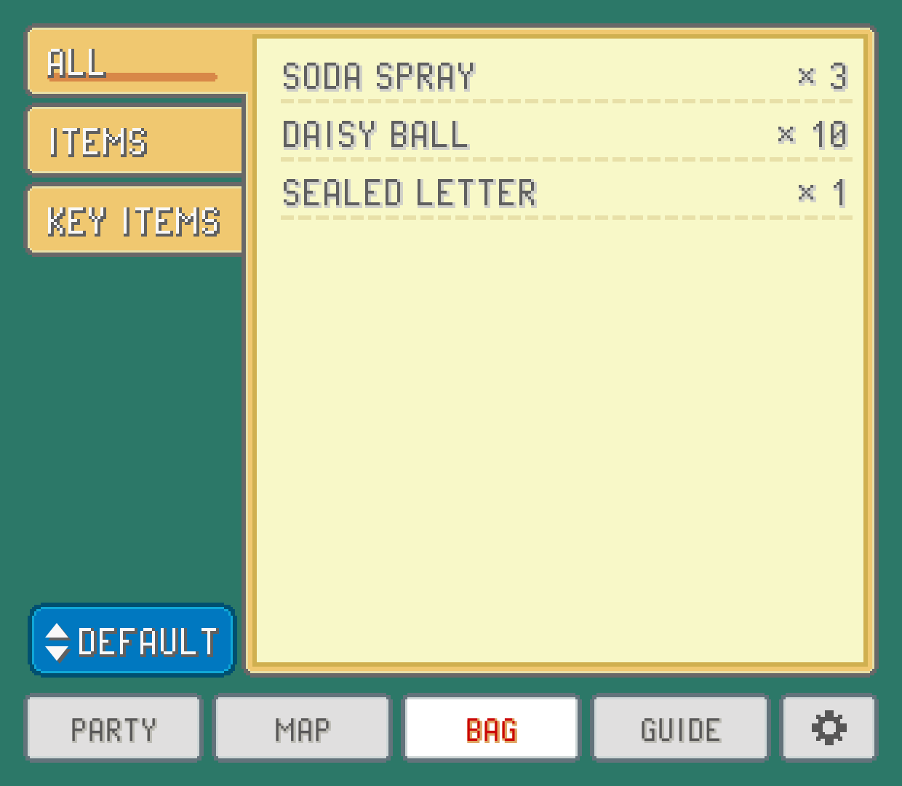
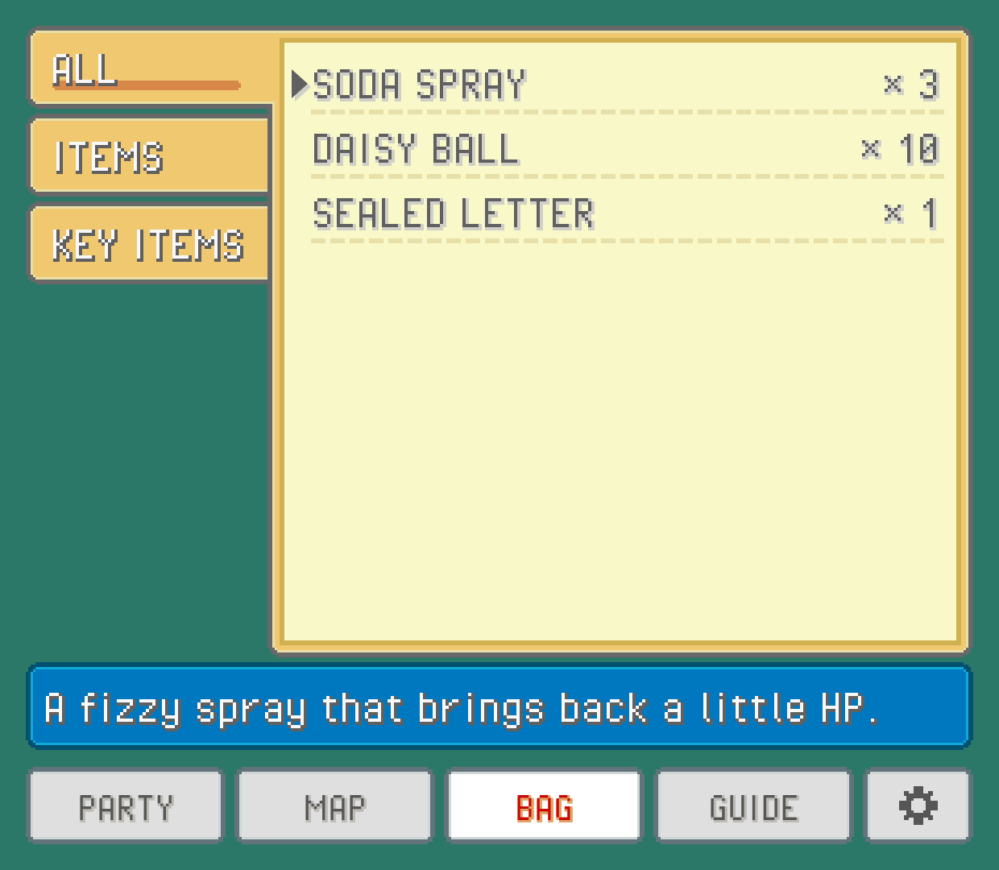

The bag tab shows everything you're carrying, pocket by pocket, as the game has it right now. It's handy for a quick count before a long cave, or for reading what an item does without digging through the game's menus.

The tab's name follows the game: `BAG` in most games, `CUBE` in Unbound, `INVENTORY` in R.O.W.E. and `POCKETS` in Super Mariomon. The screen itself is drawn like that game's bag.

## Pockets and sorting

The pockets run down the left like folder tabs. `ALL` shows everything at once; the others are the game's own pockets (items, balls, TMs and HMs, berries, key items, and whatever extra pockets a hack adds). Only pockets with something in them get a tab.

Each row has the item's name and how many you have. TMs and HMs show the move they teach after their number, the way the game's TM case does.

The button under the pockets changes the order. Each tap moves to the next: the game's own order, by name, by type, or by count (most first).

## Item details

Tap an item to open its description at the bottom of the screen, with the item's icon. Tap another item to switch, or the same one to close it.

Descriptions are read from your own ROM, in your game's words and language. That means a hack's changed items describe themselves correctly. If an item has no text here, the game's description couldn't be found in that ROM.

## Favorites

Some items you reach for all the time: your best healing item, the balls you throw most. Star them and they're always at hand.

Open an item's description and tap the star button in its bar (next to `USE`, where that shows). The item gets a gold star before its name and moves to the top of the bag's default order, ahead of everything else. Starred items keep the bag's own order among themselves, and the star shows whichever order you pick.

While you have at least one starred item in the bag, a `FAVORITES` tab appears under `ALL`, listing only those. Tap the star again to unstar an item. Unstar the last one and the tab goes away, taking you back to `ALL`.

Stars belong to the game you're playing: each ROM keeps its own set, so starring an item in one game doesn't touch your others.

## TMs: who can learn it

Pick a TM or HM and the description box also shows your whole party, each Pokémon's icon tagged:

- `ABLE`: it can learn this move.
- `NOT ABLE`: it can't.
- `LEARNED`: it already knows it.
- `BEST`: of the ones that can, the Pokémon it suits most.

Under the icons, a line names the best fit and, if its moves are full, which move it should forget for this one. The reasoning is the same as the `LEARN` page in a Pokémon's summary (see [Party and summaries](party.md)).

`BEST` and the forget suggestion follow `BATTLE HINTS` in SETTINGS: with hints off you still see who's `ABLE`, without the recommendation.

> [!NOTE]
> The TM party row works in FireRed, LeafGreen, Ruby, Sapphire and Emerald (the original games) so far.

## Using an item from the companion

In the English FireRed (rev 1) and Emerald, the description box of an item that keeps wild Pokémon away has a `USE` button. Tap it and the item is used as if you'd picked it from the game's bag: one leaves your bag, and the game counts the steps down as usual.

It only works while you're walking around. If a menu, a conversation or a battle is open, it tells you so (close the game's menus first). If the last one is still working, it says that too, and nothing is used.

> [!TIP]
> Other items and other games don't have `USE` yet. For everything else, use the item in the game as normal; the bag tab updates by itself.

## The PC from anywhere

In FireRed, LeafGreen, Emerald, Ruby and Sapphire, the bag tab has a `PC` button above the sort button (its small arrow means it opens the game's own screen, not a companion page). Tap it and the game's own PC opens right where you're standing, the same menu a PC in a Pokémon Center gives you: take Pokémon out, put them away and move them between boxes (and, outside Ruby and Sapphire, move their items). Back out of it as usual and you're on the field again.

It works in every language, and on hacks that kept those games' code: Glazed, Emerald Kaizo, Gaia, Odyssey, Orange Islands, Ultra Violet and the CFRU hacks (Unbound, Radical Red, Amethyst, Sword and Shield Ultimate Plus). Heart and Soul, SoulGold, Lazarus and Emerald Imperium have the `PC` button too, but not the bag's `USE`, `GIVE` and `TAKE` yet.

Like `USE`, it only works while you're walking around: with a menu, a conversation or a battle open, it says so instead.
